  

## Hey! 👋

I'm Shivraj Vijay Daunde!

- *Currently:* B.Tech student in AI & Data Science at **YOUR COLLEGE NAME**. <!-- EDIT -->
- *Building:* web & app projects and embedded IoT systems.
- *Open to:* internships, open-source and collaborations.

## 💻 I'm Currently Learning

**YOUR COLLEGE NAME** <!-- EDIT -->

- Data Structures & Algorithms
- Introduction to Machine Learning
- React & Redux
- Embedded Systems / IoT with Arduino

## 🚀 About My Projects

I build things that connect software with hardware: web apps, mobile apps and sensor-based IoT
systems. Add 2–3 lines here about your best project, with links. <!-- EDIT -->

| Project | What it does | Tech |
|---|---|---|
| Project 1 | One-line description | React, Firebase |
| Project 2 | One-line description | Arduino, C++ |
| Project 3 | One-line description | Python, TensorFlow |

## 🛠️ Tech Stack

## 📊 GitHub Stats

## 📫 Connect With Me

